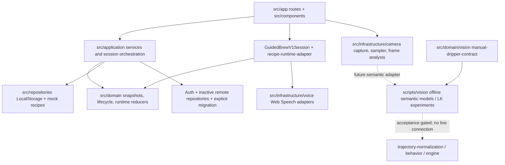

# CupMaster Current Project State

Audit date: 2026-10-14 (Asia/Taipei). Repository: `D:\Projects\CupMaster`.
This is a repository-derived onboarding audit, including intentionally uncommitted work. Research numbers below are the recorded results in repository documents, not newly reproduced model evaluations. No internet research, remote database inspection, deployment, training, private-media inspection, staging, or commit was performed.

## 1. Executive summary

CupMaster is a mobile-first pour-over coach with a working local first-cup and reflection loop. The product can prepare an immutable recipe snapshot, record execution, save a cup without feedback/AI, enrich its record, run a clearly labelled deterministic preview analysis, and create a one-change Next Try. Optional accounts and explicit Local-to-Supabase copy infrastructure exist; ordinary product storage remains LocalStorage even after migration.

HEAD freezes the manual-dripper vision contract. The working tree goes considerably beyond HEAD: completed research through 9C-5.16, a deterministic trajectory engine and synthetic robustness study (9D-1/2), recipe guidance events (9D-3), and a camera/timer/voice Guided Brew V1 integration (9D-4).

A-line semantic observation has not passed cross-session acceptance. Seen-label fit is excellent, but unseen-domain presence and tip localization remain unreliable. Partial backbone fine-tuning is rejected. Tracking and session-014 remain gated. B-line coarse behavior interpretation is implemented and tested independently, but actual A→B temporal validation has not happened. A coordinate-system mismatch must be resolved before that integration.

All 809 repository tests, lint, typecheck, and production build pass in this audit with the environment workarounds described below. This does not establish phone-browser readiness or model generalization. Guided Brew has review findings around camera fallback, persistence timing, and failure recovery.

## 2. Product goal and operating principles

Organize capabilities into Start, Guide, Reflect, Remember, Equip. Start with recipe defaults; Bean, grind, and owned gear are optional. Save Brew is independent of Feedback and Analysis. Gear Guide teaches selection; My Gear records ownership. Every Brew owns its recipe snapshot, so later source edits cannot change history. Never manufacture actual measurements from recipe targets.

The first cup, rather than Collection, is the first vertical slice. Implemented reflection extends it through optional feedback/details, preview analysis, and a focused next plan. Gear libraries, full Bean CRUD, commerce, Collection, real AI, arbitrary CV, and hardware integration are not implied by existing type declarations or design images.

Evidence: [engineering guide](../../AGENTS.md), [product architecture](../product-architecture.md), [vertical slices](../vertical-slices.md), [information architecture](../information-architecture.md).

## 3. Repository / branch state

- Branch: `feature/camera-brew-runtime`.
- HEAD: `f37303bb1502b53284d19695e678cb5c0eec9bb7`, “feat: freeze manual dripper calibration contract”, 2026-09-28.
- Local `main` and locally recorded `origin/main`: `2d66342`, pre-camera baseline. No fetch was performed; remote freshness is unknown.
- Origin: `https://github.com/yiyiyeeyi/CupMaster.git` (fetch/push).
- Before this document: 15 modified tracked files and 69 untracked files when directories are expanded, 84 entries total. No staged entries appeared. Tracked diff: 349 insertions, 29 deletions. Dirty state is intentional.
- Windows reinstall changed ownership SID. Plain Git refuses access as “dubious ownership”; read-only commands used `git -c safe.directory=D:/Projects/CupMaster ...`. No global Git configuration was changed.
- No dependency installation, lockfile update, reset, restore, clean, stash, checkout, staging, commit, or push.

### Privacy and ignore verification

`.gitignore` ignores all of `.vision-work/`; `data/vision/raw/`, `frames/`, `annotations/`, `exports/`; the actual `manifest.json`; `*.local.json` and ZIPs at that root. It also ignores env files except `.env.example`, dependencies, Next output, TS incremental output, Python bytecode, and Supabase local cache.

`git check-ignore` confirmed representative paths in the private roots. `git ls-files data/vision` lists only three public examples/schema files: `annotations.example.json`, `manifest.example.json`, `manifest.schema.json`. These are contracts, not private datasets. The ignore rules do not blanket-ignore every imaginable file under `data/vision`; use the declared private directories for new artifacts.

No private artifact contents were opened or modified. Root-directory names and ignore patterns were inspected only. Session-014 and media/annotations from sessions 005–010 were not accessed. Public documentation mentioning those sessions was read. This audit does not prove private artifacts never entered historical Git objects; a historical blob/media scan was not performed.

## 4. Architecture

### Actual subsystem map



The arrows to offline research are conceptual integration seams, not a shipped browser inference pipeline.

| Subsystem / important files | Responsibility, inputs → outputs | Dependencies / maturity |
|---|---|---|
| `src/app`, `layout.tsx`, `src/components` | Route rendering, forms, local projections, three core navigation destinations plus Me | Next App Router; server route shells with browser-interaction components; implemented MVP |
| `src/application/brew-factory.ts`, `brew-service.ts`, `brew-session-coordinator.ts` | Recipe + validated prepare input → plan/snapshot/draft; lifecycle commands → stored Brew/results | Domain + repository contracts; implemented local product |
| `suggested-plan-service.ts`, projections, journal loader | Analysis recommendation → explicit one-change plan → deterministic resulting Brew; batched UI projections and repair/sync actions | Local repositories; implemented |
| `src/domain/types.ts`, `schemas.ts`, `src/data/local-brew-schema.ts` | Domain entities, Zod validation, versioned hydration; source Recipe versus immutable execution history | Pure contracts; implemented, guidance additions uncommitted |
| `src/domain/brew-runtime`, `brew-runtime-controller.ts` | Timestamped start/pour/tick/pause/restart events → stage state and exactly-once guidance history/subscriptions | Pure reducer + pour detector; tested runtime, new guidance uncommitted |
| `camera-capture-service.ts` | Permission/rear-camera request → stream, state, video attachment, track cleanup | getUserMedia, secure context; browser adapter implemented |
| `frame-sampler.ts`, `frame-analysis-service.ts` | Live video → ephemeral ImageData at default 10 FPS → downsampled ROI motion/lighting diagnostics | Canvas/requestAnimationFrame; prototype analysis, not spout recognition |
| `dripper-positioning.ts`, `guided-brew-v1-session.ts`, `guided-brew-v1.tsx` | Confirmed placement + stability → READY; touch/voice → timed recipe and completion callbacks | Existing camera/runtime/local services, 250 ms timer; implemented uncommitted controlled-trial integration |
| `web-guidance-voice.ts` | Guidance events → zh-TW synthesis, dedup/replay/mute; final 開始 transcript → start callback | Browser Speech APIs; optional integration, device behavior unverified |
| `manual-dripper-contract.ts`, `hybrid-runtime-contract.ts`, `vision-metrics.ts` | Source-pixel calibration/search geometry and replaceable detector/localizer/tracker contracts | Pure TypeScript; frozen research contracts, not full runtime implementation |
| `scripts/vision/task9c*.py` and normalizers | Explicit local datasets → CPU training/evaluation, QA, offline state/tracking experiments | PyTorch/torchvision, Pillow, NumPy, ONNX/ORT, OpenCV, ffmpeg; research-only |
| `trajectory-types.ts`, `trajectory-normalization.ts`, `trajectory-behavior.ts`, `trajectory-engine.ts` | Source-pixel tip + confidence + time + ellipse → robust normalized history and behavior state | Pure domain, no camera/model/React/storage dependency; implemented uncommitted prototype |
| `src/repositories`, `src/infrastructure/repositories/repository-composition.ts` | Repository contracts → local Profile/Brew/Plan storage and fixture recipe reads | LocalStorage, compile-time local runtime policy; implemented |
| `src/auth`, `src/lib/supabase`, `src/infrastructure/supabase`, `supabase/` | Optional account/session, authenticated remote adapters, explicit migration/checkpoint/verification | Publishable-key SDK + mapper/RLS boundary; infrastructure implemented, live remote state unverified |

Intentional boundaries: components do not query Supabase directly; repositories isolate storage; services own commands. Auth mode does not select runtime persistence. Brew data is distinct from in-memory camera/runtime state. Vision geometry does not learn recipe intent. Trajectory behavior does not contain coaching copy. Browser speech is outside the reducer. Some components still construct local repositories directly; composition consolidation is documented debt.

## 5. Implemented functionality

### Local product

Onboarding records display name, experience, optional needs. Discover reads five validated fixture recipes through the mock recipe repository. Recipe detail and Quick Prepare accept overrides, calculate ratio, retain parameter provenance, and create independent plan/snapshot objects.

Brew supports persistent lifecycle and stage results, completion, separate Save Brew, Journal projections, detail, optional quick rating, flavor feedback, and later Bean/equipment/actual-value notes. Missing actual scale/weight values remain null. Snapshot-based history survives source-recipe changes. Suggested Plan flow supports explicit acceptance/override, deterministic resulting Brew identity, reopening, source-scoped lists, and user-triggered repair/retry.

Analysis is `RuleBasedBrewAnalysisProvider`, a deterministic local preview behind a replaceable contract. Structured evidence/data quality, source fingerprint/outdated state, failure retention, and one-change plans exist. No real AI model/server API is connected.

Optional email/password Auth, recovery, profile bootstrap, confirmation/resend UI, migration review, explicit one-time copy, checkpoints, conflict preflight, two-phase references, and remote verification infrastructure exist. Sign-in does not sync data. Continuous Cloud 5 sync is unstarted. Historical Cloud-phase headings are cumulative notes and may lag later paragraphs.

### Camera and newest guided flow

The committed camera QA path is `/dev/brew-vision` with camera/sampling/heuristic analysis and a deterministic controller. Motion evidence must not be confused with validated physical pour detection.

Current working-tree `LiveBrewDraft` sends every `not_started` Brew with stages to `GuidedBrewV1`, after pending Suggested Plan confirmation. Already-started records use the legacy manual view. Camera preview starts; user explicitly confirms placement; motion ≤0.08 for ≥1,200 ms and ≥8 frames reaches READY. Three consecutive ≥0.16 observations remove READY before brewing. Stability is not semantic dripper detection.

Touch and opt-in supported speech start share an idempotent boundary. A separate 250 ms timer advances stages at each snapshot step's duration, regardless of semantic vision. Guidance start/detail/end events update visible text and system speech; pause/resume, early-runtime restart, replay, mute, progress, stage list, and completion links exist. Completion persists a completed **draft**; user still chooses Save Brew.

The displayed ellipse is fixed, not the draggable/resizable source-pixel calibration UI described by 9C-5.4. No spout model or trajectory coaching feeds this route. Reload after execution starts deliberately falls back to manual view. Scale/OCR start is reserved as `SCALE_CAMERA`, never emitted.

### Planned / absent

Full Gear Guide/My Gear implementation, Bean library, Collection, real AI, browser ONNX inference, automatic dripper recognition, accurate scale measurements, BLE, OCR, AR, full guided reload recovery, and continuous cloud synchronization remain absent or planned. Product calls itself a PWA; no app manifest/service-worker/offline-install implementation was found in the route/public/config inventory.

## 6. Vision A-line

### Constrained V1 and calibration contract

[9A](../vision/spout-tip-research.md) supports near-top-down 75–90° fixed-camera gooseneck scenes, visible dripper/bed and identifiable physical outlet. Arbitrary camera geometry, 45°/extreme side views, 3D reconstruction, arbitrary kettles/occlusion/backgrounds are excluded.

[9C-5.4](../vision/task-9c5-4-manual-dripper-roi-contract.md) replaces detector-first acquisition with manual ellipse → bounded search → coarse/local tip → within-pour tracking → lost/reacquire. Balanced search expands left/right 1.50R, top 2.00R, bottom 0.75R; R = sqrt(radiusX×radiusY). Wide-entry is only a declared experiment. Source coordinates must undo rotation/display crop/mirror. Search clipping is guidance, not silent full-frame fallback.

Frozen A coordinates are isotropic `u=(tipX-centerX)/R`, `v=(tipY-centerY)/R`; ellipse rotation does not rotate them. Normal between-pour absence closes segments and never forces recalibration. Confirmed absence must emit no invented points. Vision assistance failure should leave timer/manual brewing and saving usable.

### Dataset / provenance history

Pilot: 42 first-party frames from 001–004, 30 positive/12 negative, revised CVAT QA passed. Initial candidate/190-frame selection reports are historical planning, not the final training pool. Final frozen first-party set is 88 frames, 60 positive/28 negative: train 001–002 (49), validation 003 (17), original held-out 004 (22).

After 004's recorded failure it became development data; later LOSO folds are cross-session development evaluation, not a fresh final test. Sessions 011–013 were explicitly authorized external research material, research-training eligible but **not production-training eligible**; 103 reviewed VIA records added 62 positives/41 negatives, giving 191 total. Earlier provenance/annotation-blocked reports were superseded by later explicit research permission and reviewed normalization.

Sessions 015–019 later formed a user-confirmed training-eligible targeted package. Do not infer that all these recordings are administratively first-party: 019's source class is explicitly left unspecified. Original 015–018 audit found no verified water-off contrast at its coarse cadence, insufficient true outlet edge cases, and correlated white setups 017/018. The later package authorization supersedes the early rights block, not those diversity limitations.

51 targeted frames were selected (32/19 candidate hints), then normalized as 24/27 labels with 48 dripper geometries. Task 14A found three identifiable outlets mislabeled absent: 016-t002000 and 019-t000000/t000500. Human correction and 14B normalization produce 27 positives/24 negatives, including only two tagged water-off positives. Combined complete pool is 242 frames (149/93); manual-ROI eligibility is 224 (149/75). Eighteen geometry-less negatives are excluded without fabricated calibration. Session-014 is sealed external holdout; 005–010 remain untouched external benchmark.

### Experiment ledger: objectives, configuration, measured findings and current relevance

Unless stated otherwise, 5.5–5.10 use seven LOSO folds over 001–004/011–013, fixed Balanced crops, frozen MobileNet features, and 0.50 presence threshold. These are development findings, not phone inference results.

| Task | Objective / dataset / configuration | Recorded quantitative result | Conclusion / current relevance |
|---|---|---|---|
| 9C-2 | 49 train / 17 validation; frozen MobileNetV3-small, 224 RGB, small spatial heads; full keypoint versus GT/predicted detector ROI | Mean error A1 .3979R, GT ROI .1556R, predicted ROI .2555R; B0 IoU≥.5 recall 8/12 | ROI helps; detector crop error erodes benefit. Offline ONNX feasibility passed; historical baseline |
| 9C-3 | Same split; ROI padding and training jitter | Selected R4/30% crop: validation mean .0836R, median .0641R, P90 .1927R | Useful local robustness on one domain; not generalization acceptance |
| 9C-4 | Continuous 003, detector/keypoint plus OpenCV LK; three offline modes | Hybrid C mean .4852R, P90 1.0477R, negative FP 2/2; ~90% reduction in semantic calls versus B | Compute savings real, drift/absence safety failed; historical tracker only |
| 9C-4.1 | Independent frozen small full-frame binary gate, 001–002 training/003 validation | Gate B static recall 100%, specificity 80%; true exits LOST 3/3, no absence crossings, 3 false splits | Narrow temporal gate passed only on 003 |
| 9C-5 | Frozen original 004 held-out test | Gate B recall 0/14; detector threshold passes 8/14, bbox IoU≥.5 none; end-to-end tip containment 4/14; Mode B mean .8594R | Decisive generalization failure; external evaluation stopped |
| 9C-5.1/2 | Domain audit then four-fold full-frame global→local recovery, small backbone, 65%-image ROI, 80 final epochs | Global/local containment 59/60; 004 locate 85.71%, mean .4355R, P90 .7438R | Detector-first crop failure reduced; semantic tail still too large |
| 9C-5.3 | Reviewed 103 external-research additions; 191 frames, seven-fold global→local | 011/012/013 global locate 36.8%/20%/4.3%; refined 004 locate 64.3%, P90 .956R | Targeted material broadened diagnosis but failed gate; earlier “annotation required” status obsolete |
| 9C-5.4 | Pure manual ellipse/search/visibility contract, no model run | Balanced margins and coordinate/segment rules frozen | Current primary spatial contract, not full UI implementation |
| 9C-5.5 | 176 ROI-eligible frames, 122/54; small coarse→65%-search local head, 80 epochs | Balanced and Wide contain 100% positive tips; refined pooled recall 73.0%, specificity 83.3%; 013 recall 0%, 004 P90 .986R | Manual region recovers 011 but not semantics; Wide adds clipping without containment gain. Geometry warnings do not explain positive collapse |
| 9C-5.6 | Same pool; tip-only versus bbox neck-first versus joint bbox/tip | 004 locate 92.9%→28.6%/42.9%; 013 neck-first 8.7%, joint 21.7%; structure P90 ~1.54R on 004 | Bbox supervision not a robust prerequisite; direct tip retained as better diagnostic |
| 9C-5.7 | Same pool; independent presence BCE + positive-only 28×28 heatmap; frozen small/large | Large 013 recall 73.9%, specificity 87.5%, raw heatmap usable 100%; 004 presence 14.3%; 012 specificity 0% | Heatmap recovers white/low contrast, presence bottleneck persists; no export/tracking |
| 9C-5.8 | Same pool; standalone presence+bbox (no tip), small versus large | Large 004 recall 92.9% but 013 4.3%; 012 IoU≥.30 recall 0%, specificity 37.5% | Recognition/structure itself unreliable; high confidence can box coffee bed/background |
| 9C-5.9 | 62 reviewed centerlines + 54 negatives; frozen large, 56 heatmap; centerline-only and joint tip, 60 epochs | Centerline 013 recall .667/spec 1.0 versus bbox .083/.875; 004 recall .100 and usable endpoint 0 | Useful structure, inconsistent domains; do not expand annotation. QA passed 62/62 |
| 9C-5.10 | Same 116 frames; final-only 112 versus multiscale block-6 skip at 56/112; curve-gated endpoint | Short-visible recall .167→.667 and edge .000→.429 with multiscale112; 004 recall 0, 013 .333, 012 specificity .375 | Fine structure gains trade away semantics; resolution alone insufficient. Gate FAIL; expand centerlines no |
| 9C-5.11 | Critical-case plan → audits → 51 selected frames → manifest-authorized VIA normalization | Initial QA 24/27, geometry 48/51, unrelated VIA records ignored 91; later corrected 27/24 | Structural QA success does not prove label semantics. Targeted diversity still incomplete |
| 9C-5.12 | Visual/audit-only 20 water-on + 4 controls, repeat reading on 10; no model/schema change | Impact clear 7/20, approximate 8, ambiguous/unavailable 5; repeatability median tip .0151 versus impact .0485 ellipse units; tip→impact median 1.160 | Optional multi-signal direction, not replacement. Sparse stills do not validate continuous trajectories; original control labels superseded by 14B |
| 9C-5.13 | 224 eligible 146/78, 12 LOSO; frozen large presence/heatmap and separate region head; 80 final epochs | Unusable 46.6%→41.8%, medium 9.6%→17.8%, high unchanged; tagged-negative FPR 16.7%→25% | Partial data benefit, regressions remain; MORE_DATA provisional until label audit |
| 9C-5.14A | Human semantics audit of 27 targeted negatives | Three mislabels, 24 valid negatives, no unresolved ambiguity; zero correctly labelled water-off positives then | Necessary small policy correction, not dataset-wide contamination |
| 9C-5.14B | Only labels changed; identical frozen protocol, 224 eligible 149/75, 12 LOSO | Presence 72.5% recall /76% specificity; 019 0/6; unusable 47%, high 2.7%; tagged-negative FPR 23.8% | LABEL_FIX_NO_MEANINGFUL_EFFECT; corrected labels authoritative, model gap remains |
| 9C-5.15 | Same frozen large config; train-fit, duplicate-group-aware 35/13 split on 015–019, prior LOSO reference | Train-fit recall/spec 100/100; in-domain 71.4/83.3, presence-gated usable tips 3/7; 019 water-off presence 2/2 in-domain versus 0/2 LOSO | MIXED: can fit seen domains; independent-session and tip generalization unsolved |
| 9C-5.16 | Paired ten-epoch partial fine-tune blocks 13–16, backbone LR1e-5/head2e-4; same split/LOSO/labels | LOSO R/S 72.5/76→71.1/80; raw tip mean .198→.315R, P90 .405→.533R, ≤.20R 71.1→51%; 019 recall remains 0 | FINETUNE_NOT_HELPFUL; retain frozen representation. Full fine-tune not run (CPU estimate 4.7h), not proven ineffective universally |

Sources are the correspondingly numbered documents under [docs/vision](../vision/). Script stems mirror task numbers; focused tests accompany model, geometry, normalization and reporting code. These scripts produce ignored checkpoints/results/predictions/QA/contact sheets; their presence in source control does not mean those artifacts should be committed.

### Current decision, separated by failure type

- **Capacity:** frozen head can fit all corrected seen observations, including water-off and hard negatives. Train-fit is a memorization diagnostic, not deployment proof.
- **Labels:** three human corrections are complete; necessary correctness improvement, insufficient to repair generalization.
- **Domain generalization:** unreliable. Frozen LOSO critical recalls 004 7.1%, 013 52.2%, 015 28.6%, 019 0%; 003 specificity 40%, 012 25%.
- **Presence gating:** 019 raw tip ≤.20R on 5/6 yet all rejected; a presence failure can hide useful localization. Water/pour shortcut is plausible, not causally proven.
- **Tip localization:** raw LOSO mean .198R/P90 .405R, only 17.4% ≤.06R; presence-gated ≤.20R usable 53%. In-domain top-edge 019 error reaches 2.586R even when accepted. Not ready for reliable precise coaching.
- **Partial fine-tuning:** improved in-domain 100/83.3 presence on just 13 frames and some negative rejection, but worsened positive difficult-domain recall/localization; do not adopt.
- **Tracking:** blocked by semantic acceptance. Historical LK runner exists; no current model replay or browser integration is authorized by those old successes.
- **Next data:** latest 5.16 supersedes earlier size plans: **four independent setups, 40–48 selected frames**, two dark/reflective/top-edge 004/015-like and two low-contrast short-visible light/reflective 013/019-like. Per setup: three outlet-visible water-on, three outlet-visible water-off, four–six matched outlet-absent negatives including body/shaft, reflection/rim/foam, hand where natural. Avoid adjacent-frame padding and a domain family confined to one setup. Repeat frozen LOSO first; separately consider a representation/gate that does not force one spatial map to serve presence and precise tips.
- Do not open 014, tune thresholds on held-out folds, broaden collection indiscriminately, expand centerlines, or spend full-fine-tune CPU on this same tiny pool.

## 7. Trajectory/coaching B-line

[9D-1](../vision/task-9d1-trajectory-coaching-engine.md) implements source-pixel observation injection:
`SpoutTipObservation { timestampMs, tip: Point2D | null, confidence }` → `SpoutTrajectoryObservationConsumer.acceptObservation()` → `TrajectoryCoachingState`.

Input times are finite, nonnegative, strictly increasing. The engine stores observed/uncertain/missing/outlier history, accepts confidence ≥.50, rejects speed >5 normalized radii/s, uses causal EMA with 140 ms constant, a 900 ms feature window, ≥300 ms evidence, ≥4 samples, and 200 ms state-change hold. Gap >300 ms since last accepted point clears the segment/evidence. Missing points remain null; short gaps may preserve degraded behavior, never interpolated positions.

Behavior dimensions are separate: inward/outward/stable-radius/unknown; clockwise/counterclockwise/unknown; stationary/moving/unknown; circular/inward-spiral/outward-spiral/undetermined. Outputs are coarse behavior/features/reliability, **not a complete recipe comparison score or corrective coaching policy**. There is no pixel-perfect reference-path matcher.

[9D-2](../vision/task-9d2-coaching-robustness-error-budget.md) uses deterministic ~4-second synthetic references, ~11.5Hz irregular samples, one ellipse/seed and limited speeds/combinations. Results are engineering boundaries, not real-video population statistics:

| Dimension | Practical target / measured boundary |
|---|---|
| Active angular direction | ≤.06 per-axis jitter target; tested direction stable through .10 |
| Radial / spiral | ≤.02 per-axis jitter target; .04 degraded ceiling with UNKNOWN; .15 jitter can give incorrect states |
| Stationary versus moving | ≤.01 per-axis jitter; .02 can be UNKNOWN, .04 falsely MOVING |
| Stable center-relative bias | ≤.04 target for radial; first errors .08, clearly unsafe .12; direction-only tolerated tested .20 |
| Availability | ≤300 ms age from last accepted observation; longer gap resets and reacquires in ~.63–.68 seconds |
| Outliers | Existing 5 radii/s guard safely degrades tested isolated .40–1.20 displacement; plausible smaller jitter still matters |

More smoothing (220ms) improved some correct ratios at .10 jitter but introduced confident wrong states; default 140ms was retained. Reliability is not a proof of semantic correctness: systematic bias/plausible jitter can be marked reliable and still coach incorrectly.

9D-3 optional recipe guidance is implemented in the working tree: seconds-to-ms adapter, deep copied guidance in plan/snapshot, scheduled start/detail/end events, stable run/stage/detail IDs, query/subscription, pause/resume/restart handling. 9D-4 consumes recipe guidance, not trajectory outputs.

## 8. A↔B validation state and workstream interfaces

A owns camera/calibration/semantic presence/tip/tracking/segment observations. B owns normalized preprocessing/features/coarse interpretation and future tolerance/coaching. C is the validation obligation: actual A output must satisfy B's separate jitter/bias/availability/outlier/stationary budgets. No dedicated C runtime or real-video acceptance harness was found.

Interfaces exist as TypeScript contracts for pixel geometry, hybrid detector/keypoint/tracker adapters, calibration/search, and `SpoutTrajectoryObservationConsumer`. A browser semantic adapter, shared coordinate version, confidence calibration, temporal telemetry and recipe-aware coaching policy remain conceptual.

**Confirmed mismatch:** 9C-5.4 mandates isotropic effective-R coordinates and expressly forbids silently substituting ellipse-aligned coordinates. `trajectory-normalization.ts` instead removes ellipse rotation and divides x/y by radiusX/radiusY; 9D-1 docs and tests intentionally assert this. For radii 200/160, a 20px x error is .112 effective-R but .100 ellipse-x; y is .125 ellipse-y. Coordinate magnitudes and radial semantics differ. Keep these budgets labelled in their original units; do not directly compare static effective-R errors to B per-axis ellipse jitter or infer temporal jitter from sparse static mean error.

Manual-contract movement tolerance ≤.10R is also more permissive than B's ≤.04 radial-bias target. “Minor movement” that is UX-tolerated need not be safe for radial coaching. Direction-only degradation may remain useful. No runtime conflict exists yet because the streams are disconnected.

Tip is also not the impact point. 9C-5.12 finds meaningful geometric/semantic displacement and variable impact identifiability; future bed-target coaching must specify what observation represents. No impact model/schema was shipped.

## 9. Data / product / UI state

Recipe fixtures are local curated code, not an imported external recipe database. RecipeVersion, RecipeStep, resolved defaults/overrides, BrewPlan, snapshot and Brew are explicit concepts. Local envelopes use version 1; per-record validation preserves valid records when another is malformed. Profile, Brew, Suggested Plan, and migration checkpoints have separate repository responsibilities.

Execution and saved-record status are distinct. Feedback, record details, latest successful analysis and latest analysis attempt are separate fields on the Brew. Journal projects the repository, not duplicate cup entities. Suggested Plan copies one permitted change and preserves source provenance without changing historical Brew/Analysis/Recipe.

Routes include onboarding/discover/recipe/prepare/brew/complete, journal/detail/feedback/edit/analysis/source-plans, recommendation-to-plan confirmation, plan detail, Me, Auth, migration and dev QA. `docs/routes.md` and older slice notes understate newest camera/pause/completion behavior; current code plus newest task docs are authoritative for this audit.

Twenty reference PNGs in `design/` describe intended screens, including future Collection/Ask AI. Their existence is not evidence those features shipped. `design/README.md` restricts redesign; engineering/product rules explicitly keep Bean optional despite some older reference flows.

No BLE/Bluetooth adapters, scale protocol, external coffee-project integration or imported coffee data package was found in source/dependencies/docs searches. Equipment's “scale” category, target weights and reserved SCALE_CAMERA source are conceptual support. Timers are timestamp-derived; actual weight remains null. ML/open-source framework/license research exists, but it is not coffee-product integration.

Supabase SQL migration, seed, RLS SQL tests, provisional generated types, row schemas, mappers, remote repositories, fault-injection gateway and migration recovery tests are checked in. This audit does not establish remote schema deployment, current RLS correctness on a live account, or current migration data. No cloud calls were made.

## 10. Research findings already established and timeline

| Date / order | Milestone and significance |
|---|---|
| 2026-07-15, cb882e3 | Project initialization |
| 2026-09-16, 2d66342 | Pre-camera baseline: local first-cup/reflect/next-plan loop and optional cloud infrastructure |
| 2026-09-17, 6197855→73b009c | Runtime types, stage reducer, hysteretic pour detection, application controller |
| 2026-09-17, f7d636f→70b945c | Camera capture, ephemeral sampling, heuristic frame analysis, dev QA harness |
| 2026-09-17, 6505cc6→aa76250 | Constrained vision research, dataset tooling, revised annotation pilot, candidate planning |
| 2026-09-24, 7e0830a | Dataset freeze |
| 2026-09-25, 972ef3e→fffa62c | Final first-party QA, hybrid contract, CPU baseline/ONNX, ROI robustness |
| 2026-09-25, b5a36e8→ce66629 | Continuous LK hybrid exposed drift/absence; separate presence gate improved validation exits |
| 2026-09-25, 8098ceb→217b54b | 004 held-out failure, domain-shift audit, global→local recovery with residual tail |
| 2026-09-28, ce975e6/f37303b | External-research targeted normalization/retraining failed; manual calibration contract frozen |
| Uncommitted task order 5.5→5.10 | Manual crop semantics, structure, independent heatmap/presence, standalone recognition, centerlines, multiscale pilot |
| Uncommitted 5.11→5.16 | Targeted 015–019 package, impact feasibility, retraining, label correction, capacity/generalization study, rejected partial fine-tuning |
| Uncommitted 9D-1→4 | Pure trajectory engine, synthetic budgets, recipe guidance, controlled camera/timer/voice guided brewing |

Do not infer calendar dates for undated uncommitted reports from filesystem timestamps. Task order shows logical progression, not necessarily exact wall-clock completion order. Old reports saying “blocked annotation”, “camera later”, or “no Pause/Finish” describe earlier increments.

Framework direction also changed: RTMDet/RTMPose were shortlist candidates; Windows CPU constraints selected plain PyTorch/torchvision small heads instead. They were not evaluated merely because mentioned in the license audit. Early ONNX exports are offline prototypes, not browser delivery. Ultralytics is not the default proprietary-product route. ImageNet-derived checkpoint distribution still needs the recorded provenance/licensing review; permissive framework code does not establish weight/data rights.

## 11. Known problems

| Priority / confirmation | Evidence and affected subsystem | Work already underway / recommended next action |
|---|---|---|
| P0 | No confirmed repository-level blocker to basic build/typecheck/local tests after environment workarounds | Environment ownership/cache access needs deliberate setup; no source repair indicated |
| P1 confirmed: cross-session presence | 14B/15/16 LOSO critical-domain collapse, especially 019 0%; high false presence on 003/012 | Studies complete; latest targeted matched data + frozen LOSO, separate representation/gate study |
| P1 confirmed: tip tails | Frozen mean .198/P90 .405R and in-domain 2.586R tail; partial worsens | Do not reconnect tracking; assess localization separately from presence |
| P1 confirmed: coordinate contract divergence | A isotropic contract versus B ellipse-aligned code/docs/tests | Resolve/version interface and error units before real A→B validation; do not silently rewrite either |
| P1 confirmed: no-camera start fallback missing in newest path | `LiveBrewDraft` routes all new drafts to camera READY-gated GuidedBrewV1; denial/unsupported UI offers Retry, no manual alternative | 9D-4 in working tree; decide approved camera-assisted scope/fallback before treating default flow as broadly usable |
| P1 confirmed: displayed and stored timing diverge | Guided pause/resume only call in-memory runtime; callbacks use BrewService wall-clock timestamps; stored pause accumulator not updated. Restart setup similarly retains original persistent start | 9D-4 integration exists; define wall-clock versus active-duration policy, test real service+session pause/restart persistence |
| P1 confirmed recovery gap, fault scenario not exercised here | Session records transition notification before callback; callback failure shows notice but stage callback is not retried. Final completion can fail after stage-save failure | Review retry/reconciliation boundary; synthetic callbacks are not storage-failure coverage |
| P2 suspected: React effect replay removes guidance subscription | Guided component creates session once, effect cleanup calls session.dispose() (unsubscribes guidance); Strict Mode effect replay reuses that instance | Browser/dev lifecycle test needed; unit resource-scope test cannot confirm remount behavior |
| P2 confirmed: overlay/source region transform incomplete | CSS video uses object-fit cover in 4:3/square preview; analyzer uses fixed normalized source rectangle without cover transform | Accept as stability prototype only; implement canonical display/source mapping before calibrated vision use |
| P2 confirmed validation gap | No phone/browser QA executed; Speech APIs/background behavior vary; tests run Node with mocks | Controlled HTTPS phone brew and lifecycle/fault scenarios before readiness claim |
| P2 confirmed product-data/provenance limits | 011–013 research-only external material; latest pool has very few water-off positives and correlated domains | Preserve research versus production eligibility; collect independent authorized setups |
| P2 confirmed ML environment gap | Current system Python 3.14.4 has none of torch/torchvision/numpy/Pillow/ONNX/ORT/cv2 discoverable; ffmpeg/uv absent on PATH | Re-establish documented Python 3.11 environment only when research next requested; do not reinstall indiscriminately |
| P2 documentation lag | Older README/slice/route claims versus latest working-tree 9D-4; superseded annotation/data plans remain | This onboarding document reconciles them; update specific docs during an approved work round |
| P3 refinement | Synthetic budget covers limited ellipse/noise/speed settings, no real tracker drift; stationary false-motion sensitive | Broader controlled validation after A semantic gate; avoid default smoothing retune from aggregate ratios |
| P3 future scope | PWA installation/offline, Gear/Bean libraries, real AI, hardware, sync missing | Planned increments, not first-cup execution defects |

The persistence/timing and camera-fallback findings are source-derived; no user Brew was created or changed to demonstrate them. Suspected lifecycle issue is explicitly not a reproduced browser bug.

## 12. Known non-problems / frozen decisions

- Dirty/untracked research and implementation work is intentionally preserved, not disposable.
- Near-top-down fixed camera, gooseneck family and manual dripper calibration are deliberate V1 constraints.
- Approximate ellipse alignment and tolerant/coarse interpretation are intended; arbitrary 3D/side-view reconstruction is excluded.
- No invented tip points through confirmed absence; long-gap UNKNOWN/reacquisition is preferable to confident bridging.
- The full-frame detector and historical LK prototype are research comparisons; primary V1 acquisition is manual bounded search.
- Session-014 remains sealed and 005–010 external benchmark stays untouched until the appropriate new acceptance gate.
- Research artifacts/checkpoints/evaluations stay local and ignored.
- A failed semantic gate intentionally prevents tracking and browser/model runtime integration; it does not prevent independent timer/guidance development.
- Optional feedback, AI, Bean and owned gear do not gate saved cups.
- Actual weights/TDS/extraction are absent instead of fabricated.
- Local Mode after login/migration and unstarted continuous sync are explicit choices.
- Rule-based preview Analysis is deliberately labelled and replaceable, not a failed real-AI request.
- Early setup restart is restricted once stage history exists; full guided reload continuation is explicitly out of 9D-4 scope.
- Speech start is optional with touch fallback **within READY**; this does not address the separate missing fallback for camera denial.

## 13. Working-tree inventory and review readiness

### Logical groups

| Group | Files / change purpose | Assessment |
|---|---|---|
| A-line 5.5–5.10 | Six reports; matching model scripts/tests; centerline prepare/normalizer scripts/tests | Experiments appear complete, often gate FAIL. Source/docs candidates for grouped review; Python model reproduction unavailable here |
| Targeted 5.11–5.12 | Five 5.11 planning/audit/extraction/QA reports, normalizer and Node tests; impact report/script | Completed historical planning/QA/audit sequence. Preserve superseded states as history; current labels come from 14B |
| Targeted 5.13–5.16 | Retraining, label audit/correction, diagnostic and fine-tune reports; scripts/tests | Completed reported experiments with explicit decisions. Latest negative result is still completed work, not an unfinished training run |
| B-line 9D-1/2 | Two reports; trajectory types/normalization/features/engine; engine and robustness tests/helpers; modified vision barrel | Implemented/tested standalone; review-ready as prototype, coordinate integration issue unresolved |
| Guidance 9D-3 | Recipe guidance doc; adapter/test; type/schema/factory/fixture/runtime reducer/controller changes | Implemented/tested domain slice; optional nested guidance copied into historical records |
| Guided integration 9D-4 | Report, positioning/session/tests, component, voice adapter/barrel/tests, live-route switch and CSS | Implemented and build/test passing; controlled-trial/review work remains. Do not equate unit completeness with phone or persistence acceptance |
| Private generated artifacts | Ignored dataset/media/models/evaluation/cache locations mentioned in docs | Must not commit/upload. Actual private files intentionally not inventoried/opened |
| This audit | `docs/project/current-project-state-audit.md` | Sole authored deliverable of this work round |

No untracked file was treated as disposable. “Review-ready” is not permission to stage or commit. There is no repository evidence of a currently running training job or author intent to implement one specific next task; active work is inferred from latest artifacts.

### Exact pre-audit file status (expanded)

```text
 M src/app/globals.css
 M src/application/brew-factory.test.ts
 M src/application/brew-factory.ts
 M src/application/brew-runtime/brew-runtime-controller.ts
 M src/components/live-brew-draft.tsx
 M src/data/fixtures/recipes.ts
 M src/data/local-brew-schema.ts
 M src/domain/brew-runtime/brew-runtime-events.ts
 M src/domain/brew-runtime/brew-runtime-types.ts
 M src/domain/brew-runtime/brew-runtime.test.ts
 M src/domain/brew-runtime/brew-stage-engine.ts
 M src/domain/brew-runtime/index.ts
 M src/domain/schemas.ts
 M src/domain/types.ts
 M src/domain/vision/index.ts
?? docs/recipe-step-runtime-guidance.md
?? docs/vision/task-9c5-10-multiscale-centerline-endpoint.md
?? docs/vision/task-9c5-11-annotation-qa.md
?? docs/vision/task-9c5-11-critical-case-data-plan.md
?? docs/vision/task-9c5-11-new-session-audit.md
?? docs/vision/task-9c5-11-session-019-audit.md
?? docs/vision/task-9c5-11-targeted-extraction.md
?? docs/vision/task-9c5-12-pour-impact-feasibility.md
?? docs/vision/task-9c5-13-targeted-spout-tip-retraining.md
?? docs/vision/task-9c5-14a-spout-presence-annotation-audit.md
?? docs/vision/task-9c5-14b-presence-label-fix-retraining.md
?? docs/vision/task-9c5-15-presence-learnability-generalization.md
?? docs/vision/task-9c5-16-finetuned-semantic-representation.md
?? docs/vision/task-9c5-5-manual-roi-semantic-localization.md
?? docs/vision/task-9c5-6-spout-structure-experiment.md
?? docs/vision/task-9c5-7-presence-heatmap-localization.md
?? docs/vision/task-9c5-8-standalone-spout-recognition.md
?? docs/vision/task-9c5-9-visible-spout-centerline-pilot.md
?? docs/vision/task-9d1-trajectory-coaching-engine.md
?? docs/vision/task-9d2-coaching-robustness-error-budget.md
?? docs/vision/task-9d4-testable-guided-brew-v1.md
?? scripts/vision/task9c5-10-multiscale-centerline.py
?? scripts/vision/task9c5-10-multiscale-centerline.test.py
?? scripts/vision/task9c5-11-normalize-targeted.mjs
?? scripts/vision/task9c5-11-normalize-targeted.node-test.mjs
?? scripts/vision/task9c5-12-impact-audit.mjs
?? scripts/vision/task9c5-13-targeted-retraining.py
?? scripts/vision/task9c5-13-targeted-retraining.test.py
?? scripts/vision/task9c5-14a-presence-audit.py
?? scripts/vision/task9c5-14a-presence-audit.test.py
?? scripts/vision/task9c5-14b-compare.py
?? scripts/vision/task9c5-14b-compare.test.py
?? scripts/vision/task9c5-14b-normalize-corrected.mjs
?? scripts/vision/task9c5-14b-normalize-corrected.node-test.mjs
?? scripts/vision/task9c5-15-presence-diagnostic.py
?? scripts/vision/task9c5-15-presence-diagnostic.test.py
?? scripts/vision/task9c5-16-finetune-study.py
?? scripts/vision/task9c5-16-finetune-study.test.py
?? scripts/vision/task9c5-5-manual-roi-localization.py
?? scripts/vision/task9c5-5-manual-roi-localization.test.py
?? scripts/vision/task9c5-6-spout-structure.py
?? scripts/vision/task9c5-6-spout-structure.test.py
?? scripts/vision/task9c5-7-presence-heatmap.py
?? scripts/vision/task9c5-7-presence-heatmap.test.py
?? scripts/vision/task9c5-8-standalone-spout.py
?? scripts/vision/task9c5-8-standalone-spout.test.py
?? scripts/vision/task9c5-9-centerline-pilot.py
?? scripts/vision/task9c5-9-centerline-pilot.test.py
?? scripts/vision/task9c5-9-normalize-centerline.py
?? scripts/vision/task9c5-9-normalize-centerline.test.py
?? scripts/vision/task9c5-9-prepare-centerline-pilot.py
?? scripts/vision/task9c5-9-prepare-centerline-pilot.test.py
?? src/application/brew-runtime/dripper-positioning.test.ts
?? src/application/brew-runtime/dripper-positioning.ts
?? src/application/brew-runtime/guided-brew-v1-session.test.ts
?? src/application/brew-runtime/guided-brew-v1-session.ts
?? src/components/guided-brew-v1.tsx
?? src/domain/brew-runtime/brew-guidance.test.ts
?? src/domain/brew-runtime/recipe-runtime-adapter.ts
?? src/domain/vision/trajectory-behavior.ts
?? src/domain/vision/trajectory-engine.test.ts
?? src/domain/vision/trajectory-engine.ts
?? src/domain/vision/trajectory-normalization.ts
?? src/domain/vision/trajectory-robustness.test-utils.ts
?? src/domain/vision/trajectory-robustness.test.ts
?? src/domain/vision/trajectory-types.ts
?? src/infrastructure/voice/index.ts
?? src/infrastructure/voice/web-guidance-voice.test.ts
?? src/infrastructure/voice/web-guidance-voice.ts
```

## 14. Environment/setup requirements

App stack: Next 16.2.10 App Router, React/ReactDOM 19.2.4, strict TypeScript 5-range, Tailwind 4/PostCSS, ESLint 9 flat config, Zod 4-range, Vitest 4.1.10. npm only with package-lock. Supabase SDK/SSR and CLI are pinned in package.json. No explicit Node engines/packageManager/runtime pin was found in root config; @types/node 20 is not a Node runtime requirement.

Current host: Node v22.23.3, npm 10.9.9, Python 3.14.4. node_modules already exists and app checks run. Python emits a location warning but executes pure tests. No dependency changes were needed.

Historical research environment: uv 0.8.17 under `.vision-work/tools/uv/uv.exe`; Python 3.11.13 venv at `.vision-work/venv/Scripts/python.exe`; CPU four threads. Requirements: torch 2.7.1+cpu, torchvision .22.1+cpu, numpy 2.2.6, Pillow 11.2.1, onnx 1.18.0, onnxruntime 1.22.0; later tracker requires OpenCV 4.12.0. Torch CPU wheels came from the PyTorch CPU index. This audit did not inspect or execute the old private venv, so its current usability is unknown; system package absence does not prove that private installation is gone.

ffmpeg/ffprobe are required for timestamp-addressed extraction and decoding; some scripts accept an explicit ffmpeg path. uv and ffmpeg were not found on current PATH. GPU/WSL are optional for future heavier experiments; current research was CPU, not a required CUDA stack. CVAT/VIA are annotation tools, not product runtime dependencies.

Research process-scoped storage variables: VISION_WORK_ROOT, HF_HOME, HF_HUB_CACHE, HF_DATASETS_CACHE, TORCH_HOME, PIP_CACHE_DIR, MMENGINE_HOME, UV_CACHE_DIR, UV_PYTHON_INSTALL_DIR, TMP, TEMP. Direct their caches/temp to the documented private D-drive root when authorized research runs. Scripts use --repo-root/--work-root and specific previous dataset/checkpoint/result paths, so public source alone cannot reproduce private evaluation. Older environment doc's “system Python absent” is historical.

App env names: NEXT_PUBLIC_SUPABASE_URL and NEXT_PUBLIC_SUPABASE_PUBLISHABLE_KEY optional for Auth/cloud; SUPABASE_PROJECT_REF CLI-only. Local MVP needs no Supabase env. .env.local exists and build loads it; values were not read or printed. No real-AI key contract is needed by the current rule provider. Service-role/AI keys must never be public.

Modern mobile browser + HTTPS or localhost secure context for camera; remote plain LAN HTTP usually insufficient. Speech recognition is browser-dependent, TTS voice inventory OS-dependent. Foreground page/screen needed for controlled trial. Deployment tooling/config is generic Next; no browser model runtime or deployment-specific manifest was found. Supabase RLS tests require a disposable stack; Docker/CLI are optional for that work, not local brewing.

## 15. Quality gates in this audit

| Check | Result / limits |
|---|---|
| npm test | PASS: 51 files, 809 tests. Initial run: all suites failed before execution due temp-cache EPERM rename. Retry used process-scoped TEMP/TMP in allowed visualization directory and passed |
| Standalone node --test normalizers | PASS: 8 tests across 5.3, 5.11 and 14B *.node-test.mjs; these are outside Vitest include glob |
| Python pure comparison + centerline normalization | PASS: 2 + 6 tests, system Python with -B (no bytecode writes) |
| Full Python ML/vision suite | NOT RUN: current system lacks ML/image packages. No training/data loader/private model execution attempted; historical docs' passes are not current-host certification |
| npm run lint | PASS |
| npm run typecheck | PASS |
| npm run build | PASS outside sandbox; compiled, TypeScript, static generation and route collection succeeded. Initial sandbox SWC canonicalize-baseUrl access denied was environment restriction |
| git diff --check | PASS; Git emitted LF→CRLF conversion warnings, not whitespace errors |
| Supabase live/RLS SQL, mobile camera/voice, actual A→B replay | NOT RUN; requires appropriate environment, user/device or acceptance prerequisites |

Tests are Node-based Vitest, src/**/*.test.ts and scripts/**/*.test.mjs; not browser end-to-end tests. No test snapshots/lockfile updates. No npm scripts for Python suites, build-time deployment or real models were run.

Typecheck/build/test may refresh ignored .next, TS incremental/type generation and temporary caches; the audit is not literally zero filesystem writes. The only authored repository file is this document. Existing tracked/untracked source status remained unchanged before document creation.

## 16. Active / paused / blocked / future work

- **ACTIVE NOW (inferred):** review/consolidation of completed uncommitted A studies and 9D implementation; controlled Guided Brew V1 trial preparation. Latest code exists, but no running work process was established.
- **PAUSED INTENTIONALLY:** session-014, external benchmark 005–010, full centerline expansion, tracking reconnect, browser model/ONNX integration. Full fine-tune on current tiny pool omitted for measured CPU cost and unfavorable partial evidence.
- **BLOCKED:** A acceptance by presence/generalization/localization; C validation by A acceptance and coordinate agreement; complete Python reproduction on the system interpreter by missing dependencies. Camera-denied users are blocked in the new default start path.
- **NEXT LIKELY:** guided flow review/phone QA; coordinate/measurement contract; targeted 40–48-frame authorized matched capture and frozen LOSO; separate observation-gate representation investigation.
- **FUTURE / OPTIONAL:** actual temporal A→B validation, validated calibration UI/dripper movement evidence, optional impact/stream pilot, scale/OCR/BLE, real AI, Equip/libraries/Collection, cloud sync, offline/installable PWA.
- Healthy now: local domain/repository/application tests, strict typing, lint, production build and pure trajectory/guidance logic. Healthy checks do not erase the integration/acceptance gaps.

## 17. Recommended next decision points

1. Decide how Guided Brew V1 is exposed: camera-assisted opt-in versus default, and approved manual fallback; then resolve pause/restart/save-recovery semantics before controlled HTTPS phone QA.
2. Freeze/version the A↔B coordinate system, calibration accuracy and observation meaning (tip proxy versus optional impact); translate budgets explicitly instead of mixing normalized units.
3. Confirm the latest targeted data plan: four independent authorized setups, 40–48 matched frames, corrected physical-outlet semantics independent of water, no opening of sealed benchmarks.
4. Choose a constrained independent presence/observation-gate representation experiment; frozen LOSO remains the comparator, rejected partial fine-tuning does not become the baseline.
5. Review completed uncommitted slices separately (research, B engine, guidance, guided UI), retaining privacy exclusions and historical decisions; staging/commit requires a later user instruction.

No next implementation task was started. Await user direction.

